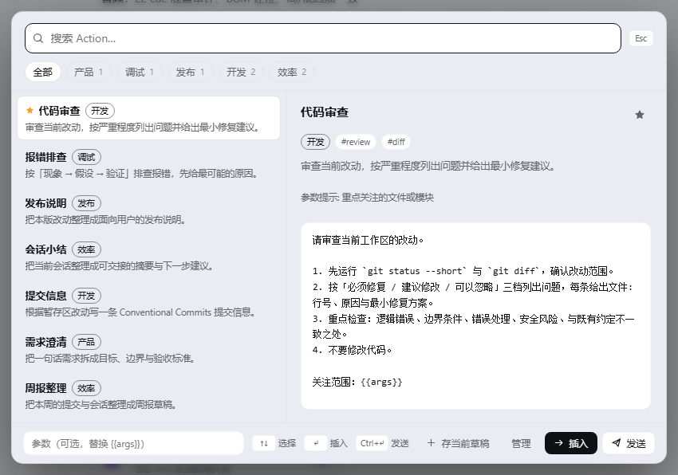
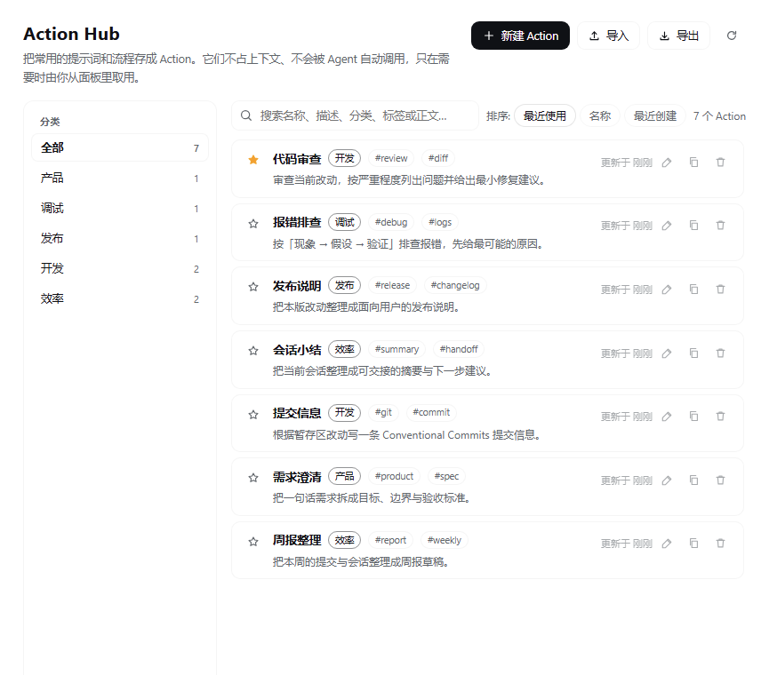
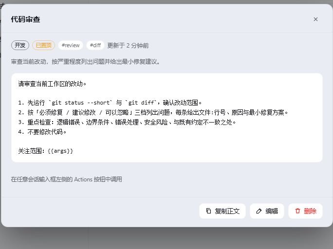
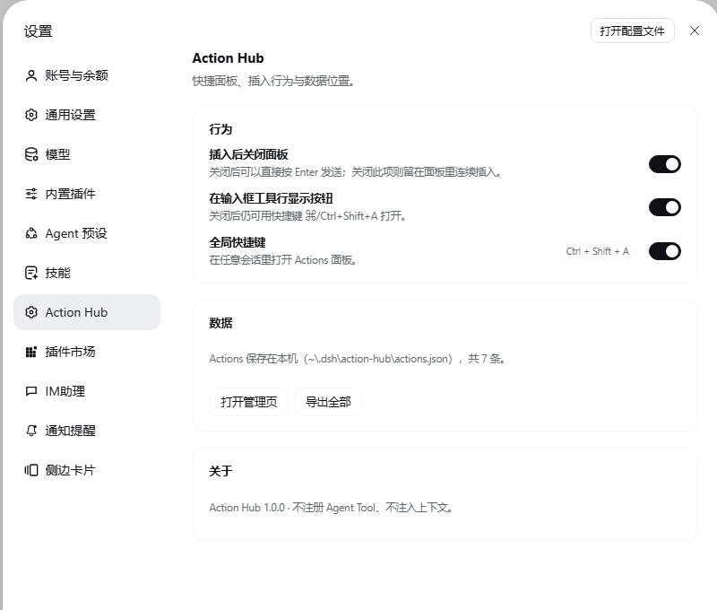

# Action Hub

**A Spotlight-style Action shelf for DSH: keep reusable prompts and flows one search away, without paying context for them or letting the agent trigger them.**

[中文](README.md) · [Changelog](CHANGELOG.md) · [DeepSeek Harness](https://github.com/deepseek-ai/deepseek-harness)

[](LICENSE)
[](CHANGELOG.md)
[](package.json)



## Why

Turning recurring prompts into Skills has two problems:

1. **They cost context all the time.** Every Skill's name and description enters the system prompt, so a large collection taxes every ordinary chat.
2. **They trigger themselves.** The agent decides when to call one. For flows like "push this branch through git-svn" you want to run it *only when you decide to*, and you may not want the agent to reach for it at all.

Action Hub separates the shelf from the trigger:

- **Zero context cost.** No agent tool, no system-prompt text. A large shelf never grows the per-turn prompt.
- **User-triggered only.** Open the palette with `Alt + A` (macOS `⌥ + A`) or the composer-toolbar button; the pick inserts a chip with the Action name, and pressing Enter sends it yourself.
- **Organized and shareable.** Categories, tags, pinning, full-text search, single/selected ZIP or folder export, and whole-library import/export.

## Screens

| Palette | Library |
| --- | --- |
|  |  |
| Search, categories, live preview, arguments — fully keyboard-driven | Category navigation, search, sorting, compact rows, detail |

| Action details | Settings |
| --- | --- |
|  |  |
| Full body, tags, usage, copy/edit/delete | Insertion behavior, shortcut, toolbar button, data location |

## Features

| Capability | Details |
| --- | --- |
| Spotlight palette | `Alt + A` (macOS `⌥ + A`) or the composer button; search, category tabs, live preview, argument field |
| Keyboard first | `↑↓` select, `Enter` insert, `Ctrl/⌘+Enter` insert-and-send, `Tab` category, `Esc` close |
| Name-chip reference | Without arguments it inserts an Action reference chip: **both the composer and the transcript show only the Action name**, and the plugin injects the body on send. No Skill is registered |
| Rebindable shortcut | Change it in **Settings → General → Shortcuts**; default `Alt + A` (the Web registry rejects single-modifier chords, so the plugin handles Alt+A until you bind something there, then DSH takes over) |
| Insert at the caret | Uses the host `inputActions.insertText()` facade: one undoable edit at the cursor, existing draft preserved |
| Capture the draft | Save the current composer draft as an Action from the palette |
| Pinning | Star an Action to keep it first in the palette and library |
| Library | Category navigation with counts, full-text search, sort by recent / name / created |
| Arguments | `{{args}}` / `$ARGUMENTS` filled from the palette; `{{date}}` becomes today |
| Resource files | Attach code, templates, docs, and fixtures to an Action; small text is inlined at invocation, larger files are listed by local path |
| Default import helper | A built-in “Action 导入助手” Action turns a Skill directory or a piece of text into an importable Action bundle |
| Import / export | Import a folder or ZIP (one Action or a whole library); export one Action, a ticked selection, or the whole library as ZIP |
| Sharing | Export one Action or the whole library as a ZIP/folder; import ZIP, folder, or legacy JSON; every Action is a self-contained directory |
| Slash command | `/action <name> [args]` runs one Action, or lists them all |

## Install

Action Hub is a DSH bundle (Host half + Web half, no build step, no runtime dependencies).

**From the plugin market** (once listed): DSH → Plugin Market → search `Action Hub` → Install → Enable.

**From GitHub**:

```sh
dsh plugin --profile desktop add "github:AhaCrazy/dsh-action-hub#main"
```

**From a local checkout**: DSH → Plugins → Add plugin → paste the absolute path of this directory → Install → Enable → reload the page.

After installing, an `Actions` icon appears in the sidebar and an Action Hub button appears at the left of the composer toolbar.

## Usage

### Open the palette

- `Alt + A` (macOS `⌥ + A`), or the leftmost icon in the composer toolbar. Rebind it in Settings → General → Shortcuts.
- Library shortcut: `Ctrl + Alt + A` (macOS `⌘ + ⌥ + A`); rebind it in the same place.
- The Action Hub settings page lists both current bindings. DSH's shortcut groups are fixed with no plugin-group API, so the entries appear under “Application” with an `Action Hub:` prefix.
- Type to search, `↑↓` to select, `Enter` to insert.

### Insert or send

- `Enter` / “Insert”: inserts at the **caret** as one undoable edit; the existing draft is kept.
- With no arguments it inserts a **reference chip**: the composer shows `@Action name` and the transcript shows only the Action name; the plugin injects the full body when the message is sent.
- With arguments it inserts the **full text**, since the arguments are part of the body.
- `Ctrl/⌘ + Enter` / “Send”: inserts and submits the current draft.

### Save content

- **Default import helper**: the library ships one “Action 导入助手” Action. Give it a Skill directory and it reads `SKILL.md` plus resources and converts them with the Skill→Action differences in mind; give it text and it turns that into a reusable Action. Either way it produces an Action bundle directory for the import below.
- **Bundle import**: Library → Import → Action bundle → choose a folder containing `action.json`, or a `.zip`. A **preview** lists each Action first, where you can skip it, import it as new, or update the local copy. Identical content is skipped by default and locally modified copies are kept. Comparisons use a content fingerprint, so importing the same ZIP twice does not create duplicates.
- **Create/edit**: “New Action” in the library, or the row's edit button.

### Resource files

- An Action's `files/` directory *is* its resource directory: put code, templates, or docs there with your file browser; the plugin deliberately has no upload/delete buttons.
- The editor only shows a read-only tree of `files/`; add or remove files externally, then refresh the library.
- New Actions are plain text by default; after saving, place attachments under `~/.dsh/dsh-action-hub/actions/<id>/files/`.
- At invocation, small text files are inlined into `<action_content>`, while larger or binary files are listed with a local absolute path and size for on-demand reads.
- Resources enter the context only when the Action is invoked; the shelf itself still costs nothing.
- Resources travel with whole-library export/import.

### Organize

- Categories are free text, summarized with counts in the sidebar; “Manage categories” renames or deletes one. Deleting asks for confirmation and reports how many Actions move to Uncategorized; the Actions themselves are kept.
- Pin with the star; search covers name, description, category, tags, and body.
### Share and back up

- Every Action is one self-contained directory:
  ```
  ~/.dsh/dsh-action-hub/actions/<id>/
    action.json      metadata, prompt, resource manifest
    files/...        resource bytes
  ```
- In an Action's details, **Export ZIP** downloads just that Action.
- The library header “Export” opens a selection list: tick the Actions to bundle (all selected by default), then download the selected ZIP. Backing up only needs `actions/`.
- Import → “Action bundle”: choose a folder (one Action or a whole library) or a `.zip`, review the preview, then import; each item can be skipped, created, or updated. Content fingerprints keep repeated ZIP imports idempotent.
- Legacy whole-library JSON import is still available under the JSON tab.

## Design

- **Host half** (`index.js`, `store.js`, `resources.js`, `bundle.js`): one directory per Action (`actions/<id>/action.json` + `files/`) with per-Action atomic writes, same-origin `/api/dsh-action-hub` routes, and the `/action` human command, which submits a genuine user message through `sessionController.prompt(..., mode: 'queue')`.
- **References**: the composer renders an Action-name chip while the draft's serialized text stays the opaque `/ah-…` marker; a reference-source codec writes the chip back to that marker. The Host expands the marker in `agent/pre-step` into one `<action_content>` message for the step. **No runtime Skill is registered**, so Actions never appear in the Skills catalog, the `/` menu, or the context panel's skill list. When an Action has resource files, the same message carries `<action_resources>`: small text inline, everything else by path.
- **Client half** (`client.js`): registers the composer-toolbar button (`conversation.input.left`), the session bridge (`conversation.input.overlay`), the frame-level palette (`shell.overlay`), the library (`main` + sidebar icon), and the settings page (`settings.section`).
- **Deliberately absent**: no `ctx.tools`, no `ctx.systemPrompt.section()`; an Action enters a step only when the user explicitly references one, so shelf size does not affect context.

## Data and privacy

- Data lives in `~/.dsh/dsh-action-hub/actions/<id>/` (under `$DSH_HOME`): `action.json` for metadata/body and `files/` for resources, with temp+rename writes. Legacy `actions.json` is migrated on first start; the old files are renamed to `.migrated-*` and kept. The old `~/.dsh/action-hub` directory is also renamed to `dsh-action-hub` on first start.
- Settings show `~/.dsh/...` rather than an absolute path with the account name.
- The plugin talks only to the local DSH Host (`/api/dsh-action-hub`); it makes no external network requests.
- ZIP/folder/JSON exports contain bodies, categories, tags, pinned state, and resources — not local usage counters. Check a body and its resources for internal information before sharing.

## Compatibility

- Targets DSH desktop / Web UI `0.2.x` (the plugin API is still in preview).
- The library and palette need the Host `webServer` service; `/action` additionally needs `commands` and `sessionController` and degrades safely when absent.
- After changing plugin files, reload the page to pick up `client.js`; Host changes require reloading the bundle.

## Development

```powershell
node --check index.js
node --check client.js
node --check store.js
npm test
```

- `tests/store.test.mjs` — data model, placeholders, pinning order, import merging, atomic persistence.
- `tests/client.test.mjs` — captures the module registration, checks pure helpers and locale completeness, asserts no tool/prompt surface.
- `tests/host.test.mjs` — same-origin check, export trimming, `/action` argument parsing.

## License

MIT © 2026 AhaCrazy
